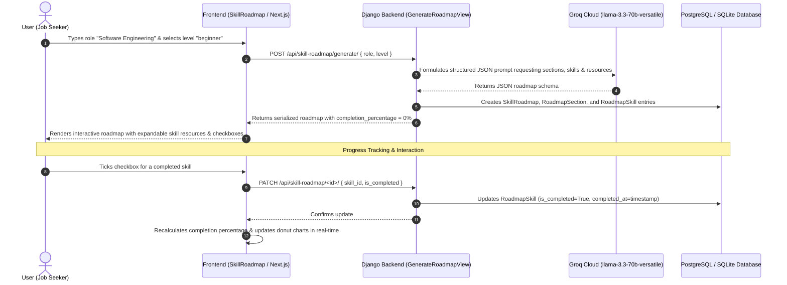

# SkillBot & Skill Roadmap Module

This module houses the complete architecture, backend code, and frontend components responsible for **SkillBot**—the AI career roadmap generator and progress tracking engine in CareerMate.

---

## 1. How It Works (End-to-End Workflow)

When a user wants to learn a skill set or career path (e.g., **"Software Engineering"** at **"Beginner"** level):



---

## 2. Directory Structure

```
skill-bot-module/
├── backend/
│   ├── models.py         # Relational database models (SkillRoadmap, Section, Skill, SkillBotChat)
│   ├── views.py          # API views: LLM generation, roadmap listings, detail, progress patch, chat
│   ├── serializers.py    # DRF serializers with dynamic completion percentage calculation
│   └── urls.py           # REST API routing endpoints
├── frontend/
│   ├── api.ts            # Axios client functions for interacting with backend endpoints
│   ├── SkillRoadmap.tsx  # Interactive UI component (setup, roadmap view, progress dashboard, chat mini)
│   └── SkillBotPage.tsx  # Next.js page entrypoint
└── README.md             # Complete architectural documentation
```

---

## 3. Backend Deep-Dive

### A. Data Models (`backend/models.py`)
- **`SkillRoadmap`**:
  - `user`: ForeignKey to User model (Job Seeker).
  - `role`: Target career role (e.g. `Software Engineering`, `Full Stack Developer`).
  - `level`: `beginner`, `intermediate`, or `advanced`.
  - `is_active`: Boolean flag indicating current active roadmap.
- **`RoadmapSection`**:
  - `roadmap`: ForeignKey to `SkillRoadmap`.
  - `title`: e.g. "Foundational Concepts", "Core Data Structures & Algorithms", "System Design", "Interview Prep".
  - `order`: Integer for chronological ordering.
- **`RoadmapSkill`**:
  - `section`: ForeignKey to `RoadmapSection`.
  - `name`: Specific skill name (e.g. `Git & Version Control`, `REST APIs`, `Docker`).
  - `description`: Actionable summary of what to learn.
  - `resources`: JSONField containing recommended courses, tutorials, and documentation URLs.
  - `is_completed`: Boolean for tracking completion.
  - `completed_at`: DateTimeField recording timestamp when finished.
- **`SkillBotChat`**:
  - Stores conversational history between user and SkillBot helper.

### B. Roadmap Generation with LLM (`backend/views.py`)
Endpoint: `POST /api/skill-roadmap/generate/`
- Uses **Groq API** running `llama-3.3-70b-versatile` with `response_format={"type": "json_object"}`.
- Generates 4–6 structured sections, each with 3–5 concrete skills, comprehensive descriptions, and curated learning platforms (Coursera, YouTube, Official Docs).
- Parses returned JSON and transactionally creates relational records in the database.

### C. Progress Tracking Engine (`backend/views.py` & `backend/serializers.py`)
Endpoint: `PATCH /api/skill-roadmap/<uuid:pk>/`
- Payload: `{ "skill_id": "<uuid>", "is_completed": true | false }`
- Automatically updates `completed_at` to `timezone.now()` on completion or clears it on uncheck.
- **Dynamic Completion Formula** in `SkillRoadmapSerializer`:
  $$\text{Completion Percentage} = \text{round}\left( \frac{\text{Completed Skills}}{\text{Total Skills in Roadmap}} \times 100 \right)$$

### D. SkillBot Context-Aware Chat (`backend/views.py`)
Endpoint: `POST /api/skill-roadmap/chat/`
- Inspects user's active roadmap.
- Injects `active_roadmap.role` and `active_roadmap.level` into system instructions.
- Powered by `llama-3.1-8b-instant` for ultra-fast, contextual career advising.

---

## 4. REST API Reference

| Method | Endpoint | Description |
| :--- | :--- | :--- |
| `POST` | `/api/skill-roadmap/generate/` | Generates a new roadmap from `{ role, level }` |
| `GET` | `/api/skill-roadmap/list/` | Fetches all roadmaps belonging to the authenticated user |
| `GET` | `/api/skill-roadmap/<id>/` | Fetches single roadmap hierarchy and overall progress |
| `PATCH`| `/api/skill-roadmap/<id>/` | Toggles skill completion status (`skill_id`, `is_completed`) |
| `POST` | `/api/skill-roadmap/chat/` | Sends user query to SkillBot assistant with active context |

---

## 5. Frontend Features (`frontend/SkillRoadmap.tsx`)
1. **Interactive Setup View**: Input field for target role (e.g. "Software Engineering") with level selector chips (`beginner`, `intermediate`, `advanced`).
2. **Dynamic Roadmap View**:
   - Accordion sections containing actionable skills.
   - Resource drawer toggling courses, articles, and video links.
   - Checkboxes to mark skills completed with real-time UI strike-through and progress updates.
   - Mini SkillBot chat widget docked in the sidebar.
3. **Progress Analytics View**:
   - Animated SVG circle completion percentage gauge.
   - Breakdown of completed vs. pending skills.
   - Streaks and shareable summary shortcuts.
